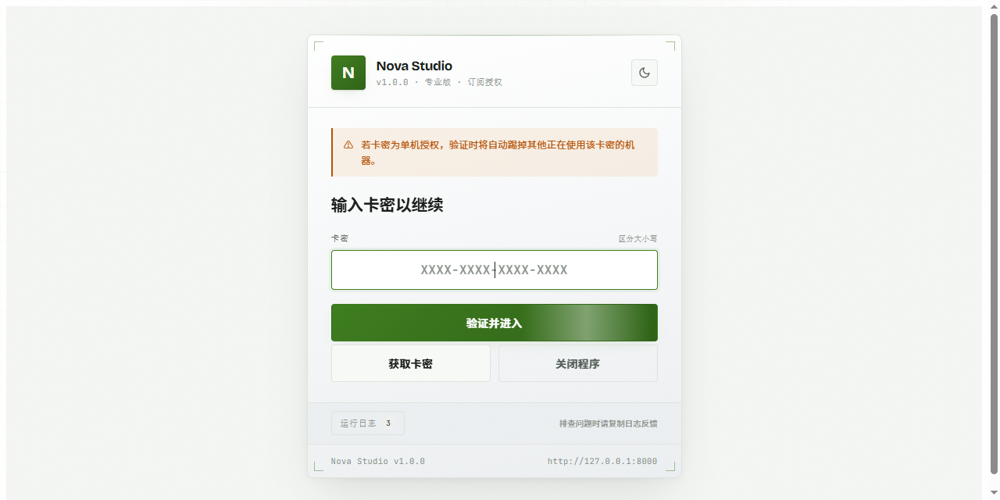
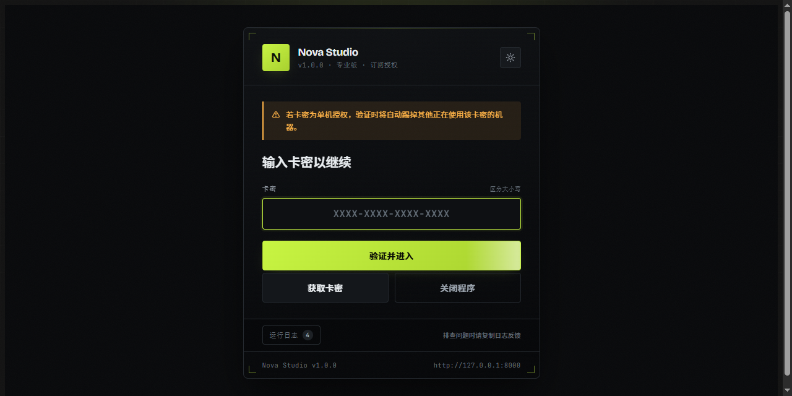
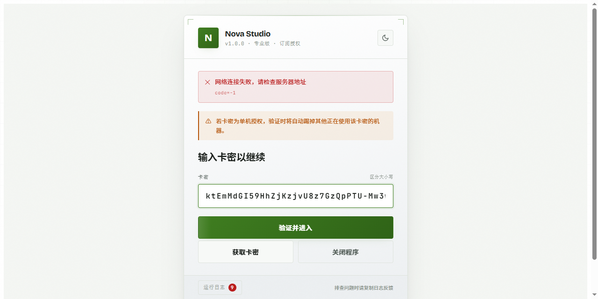
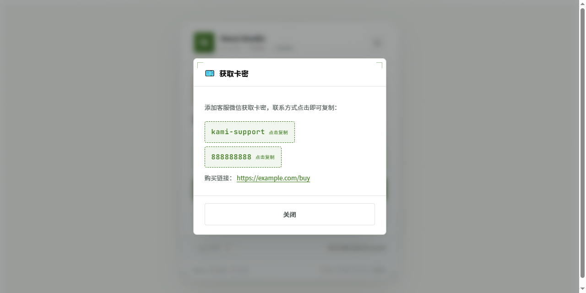
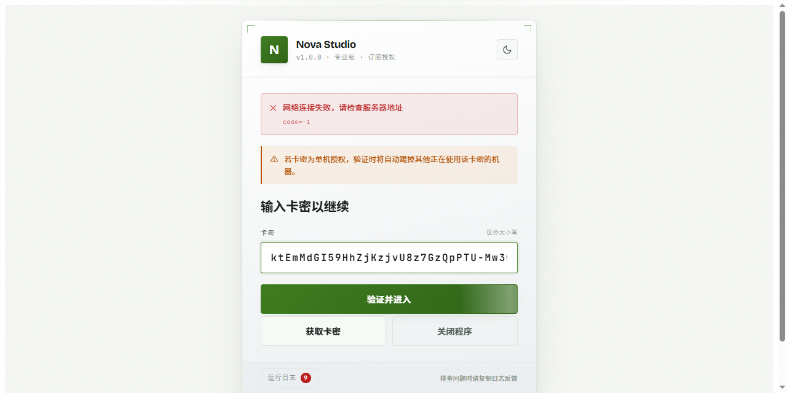
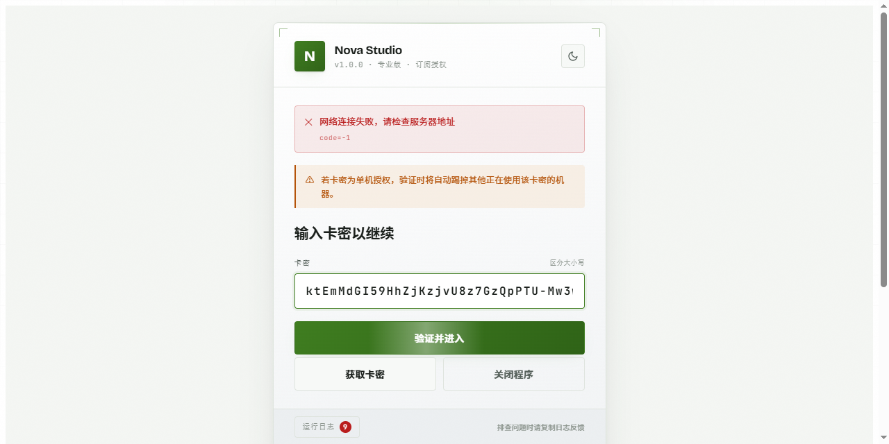

# 客户端 UI 模板

> 本目录是**卡密授权系统**的配套组件，不是一套独立的软件。
>
> 卡密系统负责生成卡密、校验授权、维护会话（服务端 + 管理后台），见 [项目根 README](../../README.md)。
> 本模板解决的是接入方的最后一公里——让每个产品的授权界面统一、规范、不遗漏必要功能。

## 为什么需要这个模板

每个应用接入授权系统时，都要做一个卡密验证界面。如果每次都从零设计，会出现两个问题：

**界面不统一** — 同一个系统下，A 产品的验证页是紫色、B 产品是蓝色，用户在不同产品间体验割裂。

**容易漏功能** — 顶号确认、退出授权二次确认、到期倒计时、日志排查这些是必需的，但每次重新实现都可能有遗漏，或者做得不严谨。

模板把这些做成了标准件：复制目录 → 改配置 → 完成。功能和视觉全部统一，新产品接入不再重复劳动，也不会漏掉必要交互。

**前提**：卡密系统本身独立运行，不依赖本模板。你也可以完全不用它，只调接口自己写界面（见 [方式二](../../README.md#接入方怎么用)）。

---

## 目录

- [功能清单](#功能清单)
- [界面预览](#界面预览)
- [文件结构](#文件结构)
- [快速接入](#快速接入)
- [接入方接口文档](#接入方接口文档)
- [配置项详解](#配置项详解)
- [集成到你的应用](#集成到你的应用)
- [常见问题](#常见问题)

---

## 功能清单

### 卡密验证页

| 功能 | 说明 |
|---|---|
| 卡密输入 | 大字距等宽显示，区分大小写，自动去除首尾空格 |
| 结果反馈 | 成功/失败都有明确提示条，失败时附带服务端错误码 |
| 获取卡密 | 支持两种模式：跳转链接 / 显示联系方式（点击即复制） |
| 单机授权提示 | 常驻顶部橙色警示条，说明顶号规则 |
| 关闭程序 | 二次确认后才退出，防止误触 |
| 记住卡密 | 本地保存，下次启动自动验证，用户无需重复输入 |
| 加载状态 | 提交期间按钮显示加载动画并禁用，防重复提交 |

### 授权成功页（应用主界面）

| 功能 | 说明 |
|---|---|
| 剩余时间倒计时 | 大号等宽数字实时刷新，接近到期自动变色（绿→黄→红） |
| 到期时间 | 精确到秒的绝对时间 |
| 授权进度条 | 按剩余比例显示，一眼看出还剩多少 |
| 授权状态徽标 | 已授权 / 未激活 / 已过期 / 已禁用，配色区分 |
| 授权详情 | 卡密 ID、会话 ID、机器 ID、产品 |
| 退出授权 | 二次确认后调服务端解绑，再回到验证页 |
| 心跳保活 | 定时上报，异常时在界面提示 |

### 顶号处理

卡密已被其他机器占用时，自动弹出确认框说明后果，用户确认后才顶号。取消则返回验证页，不做任何改动。

### 日志与排查

- 记录每个网络请求的**方向、路径、错误码、耗时（毫秒）**
- 记录验证失败时的服务端原文、会话丢失、顶号、心跳异常
- 三种筛选：全部 / 网络请求 / 仅错误
- **复制诊断**：一键导出环境信息 + 最近 40 条日志，用户报障时直接发这个
- 日志上限 300 条自动滚动，防止内存无限增长
- 卡密在日志中自动脱敏（`ktEm****Jq28`），不会泄露完整卡密

### 主题系统

- 默认**日间（浅色）主题**，右上角一键切换夜间
- 偏好本地记忆，刷新不丢失
- 可锁定固定主题，或跟随系统
- 全套设计令牌集中在 CSS 变量，换色只需改一行

### 健壮性

- 网络失败、超时、非法 JSON 都有对应的用户可读提示
- 会话失效自动返回验证页并清理状态
- localStorage 不可用时自动降级，不影响主流程
- 所有外部文案经过 HTML 转义，防止注入

---

## 界面预览

### 验证页（日间主题，默认）



### 验证页（夜间主题）



### 授权成功页



### 获取卡密弹窗

联系方式渲染成虚线框，点击即复制，视觉上与普通文本明显区分：



### 顶号确认弹窗



### 日志面板



---

## 文件结构

```
client/template/
├── index.html          页面结构（验证页 + 应用页 + 两个弹窗）
├── client-theme.css    设计系统：主题令牌 + 全部组件样式
├── client-core.js      核心逻辑：配置、API、会话、心跳、日志、交互
└── screenshot-*.png    界面截图
```

| 文件 | 作用 | 接入时是否修改 |
|---|---|---|
| `client-theme.css` | 设计系统，两套主题的令牌与组件 | 换肤时才改 |
| `client-core.js` | 全部业务逻辑 | 只改顶部 `CONFIG` |
| `index.html` | 页面骨架 | 一般不改 |

---

## 快速接入

> **前置条件**：卡密系统已部署运行，你在管理后台拿到了产品的 `product_id` 和 `api_key`。没有这两个值无法完成接入。

### 第一步：创建产品，拿到密钥

登录管理后台 http://127.0.0.1:8000 ，使用 `.env` 中 `ADMIN_DEFAULT_USERNAME` / `ADMIN_DEFAULT_PASSWORD` 配置的账号，进入「产品管理」新建产品，记下 `product_id` 和 `api_key`。

### 第二步：改配置

打开 `client-core.js`，只改 `CONFIG`：

```js
const CONFIG = {
  product: {
    name: '你的产品名',
    version: 'v1.0.0',
    logoText: 'Y',              // Logo 里的字符
    subtitle: '一句话描述',
  },
  server: {
    url: 'https://你的服务器',
    productId: '你的product_id',
    apiKey: 'app_xxxxxxxxxxxx',
    clientVersion: '1.0.0',
  },
  getKey: { /* 见下方「获取卡密」 */ },
};
```

### 第三步：本地预览

```bash
cd client/template
python -m http.server 8080
```

浏览器打开 http://127.0.0.1:8080

### 第四步：打包进应用

把这三个文件塞进你的客户端工程，`<head>` 里引 CSS、`<body>` 末尾引 JS 即可。

---

## 接入方接口文档

以下是卡密系统提供的客户端接口，模板内部也是调这些接口。**如果你不用本模板、自己写界面，照着这份文档调就行。**

所有接口都在 `/api/v1/license/` 下。

### 通用约定

**请求头**（每个接口都要带）：

| 头 | 值 | 说明 |
|---|---|---|
| `Authorization` | `Bearer {api_key}` | 必填，产品 API Key |
| `X-Product-ID` | `{product_id}` | 必填，必须与该 API Key 所属产品一致 |
| `X-Client-Version` | `{version}` | 选填，用于服务端兼容性校验 |
| `Content-Type` | `application/json` | 必填 |

**统一响应格式**：

```json
{
  "success": true,
  "code": 0,
  "message": "success",
  "request_id": "req_xxxxx",
  "data": { }
}
```

失败时 `success` 为 `false`，`data` 为 `null`，并附带错误对象：

```json
{
  "success": false,
  "code": 4010,
  "message": "会话已过期，请重新验证卡密",
  "request_id": "req_xxxxx",
  "data": null,
  "error": {
    "type": "session_error",
    "retryable": false,
    "retry_after": null
  }
}
```

---

### 1. 验证卡密 `POST /api/v1/license/verify`

校验卡密并建立会话。这是客户端启动后的第一个调用。

**请求体**：

| 字段 | 类型 | 必填 | 说明 |
|---|---|---|---|
| `license_key` | string | 是 | 卡密，长度 8~255 |
| `machine_id` | string | 否 | 机器标识，不传则由客户端生成 |
| `client_version` | string | 否 | 客户端版本 |
| `force` | boolean | 否 | 是否强制顶号，默认 `false` |

```json
{
  "license_key": "8ZvnuqFltbFUz64hS5Tmsfg5ZYsyjQoc",
  "machine_id": "M-abc123",
  "client_version": "1.0.0",
  "force": false
}
```

**成功响应 `data`**：

```json
{
  "authorization": "base64签名串",
  "session_id": "sess_xxxxx",
  "session_token": "明文令牌",
  "expire_at": "2026-11-11T09:18:02Z",
  "server_time": "2026-10-12T10:00:00Z"
}
```

> `session_token` 只在创建时返回一次，服务端只存哈希。**必须妥善保存**，后续心跳和注销都要用。丢失只能重新验证。
>
> `authorization` 是 Ed25519 签名的字符串（版本、卡密ID、产品ID、签发时间、到期时间、服务器时间、会话ID、随机数）。需要防篡改校验时用它，纯粹做授权判断的话用不上。

**顶号场景**：卡密已被其他机器绑定且传入的 `machine_id` 不同时，返回 `4001`，`message` 为「该卡密已绑定其他设备，继续验证将顶替原有设备，是否确认？」。确认后把 `force` 改为 `true` 重试即可。

---

### 2. 激活卡密 `POST /api/v1/license/activate`

不使用 `verify` 而需要走激活流程时调用。同样返回 `session_id` 和 `session_token`。

**请求体**：`license_key`、`machine_id`、`client_version`（无 `force`）

---

### 3. 心跳 `POST /api/v1/license/heartbeat`

客户端应定时调用维持会话。默认间隔 30 秒。

**请求体**：

| 字段 | 类型 | 必填 | 说明 |
|---|---|---|---|
| `session_id` | string | 是 | 验证时获得 |
| `session_token` | string | 否 | 建议传，用于校验会话归属 |
| `machine_id` | string | 否 | 机器标识 |
| `client_version` | string | 否 | 客户端版本 |

**成功响应 `data`**：`session_id`、`expire_at`、`server_time`。`expire_at` 可能因续期而变化，建议每次心跳都更新本地的到期时间。

> 心跳失败且返回 `4009` / `4010`，说明会话已失效（被顶号或已注销），客户端应清理状态并返回验证页。

---

### 4. 注销授权 `POST /api/v1/license/deactivate`

用户主动退出，解绑当前机器。调用后卡密可重新在其他机器使用。

**请求体**：`session_id`、`session_token`

**成功响应 `data`**：`{ "deactivated": true }`

---

### 5. 查询详情 `GET /api/v1/license/info`

获取卡密当前状态。

> 注意：这是 **GET** 接口，参数走 **query string**，不是 body。

**查询参数**：`session_id`（必填）、`session_token`（选填）

```
GET /api/v1/license/info?session_id=sess_xxxxx&session_token=xxxxx
```

**成功响应 `data`**：

```json
{
  "product_id": "nova_studio",
  "license_id": "L-SsQQlYYoh90",
  "status": "ACTIVE",
  "activated_at": "2026-10-12T10:00:00Z",
  "expire_at": "2026-11-11T09:18:02Z",
  "server_time": "2026-10-12T10:05:00Z"
}
```

---

### 错误码表

| 码 | HTTP | 含义 | 客户端建议动作 |
|---|---|---|---|
| `0` | 200 | 成功 | — |
| `4001` | 400 | 卡密无效 | 若提示含顶号意图，弹确认框后带 `force=true` 重试 |
| `4002` | 404 | 卡密不存在 | 提示用户检查是否输错 |
| `4003` | 200 | 卡密已过期 | 引导续费 |
| `4004` | 200 | 卡密已禁用 | 提示联系客服 |
| `4005` | 400 | 产品不匹配 | 检查 `X-Product-ID` 与 API Key 是否配套 |
| `4006` | 401 | API Key 无效 | 检查客户端配置 |
| `4007` | 422 | 请求参数无效 | 检查参数类型，GET 接口别把参数放 body |
| `4008` | 401 | 签名验证失败 | 检查 Ed25519 公钥配置 |
| `4009` | 401 | 会话无效 | 清理会话，返回验证页重新验证 |
| `4010` | 401 | 会话已过期 | 同上 |
| `4013` | 429 | 请求过于频繁 | 退避后重试 |
| `4014` | 400 | 客户端版本过低 | 提示升级 |
| `4015` | 403 | 产品已停用 | 提示联系客服 |
| `5001` | 500 | 服务器内部错误 | 提示稍后重试 |

---

### 典型接入流程

```
启动应用
  ↓
生成/读取 machine_id
  ↓
从本地读取记住的卡密
  ├─ 有 → 直接调 verify
  └─ 无 → 显示验证页，等用户输入
  ↓
verify(force=false)
  ├─ 成功 → 启动心跳 + 倒计时 → 进入应用主界面
  ├─ 4001 且含顶号提示 → 弹确认框
  │     ├─ 确认 → verify(force=true)
  │     └─ 取消 → 留在验证页
  └─ 其他错误 → 提示对应错误码对应的文案
  ↓
运行期间
  ├─ 定时心跳（默认 30s）
  │    └─ 失败且 4009/4010 → 清理状态，跳验证页
  ├─ 用户点「退出授权」→ 二次确认 → deactivate → 回验证页
  └─ 用户点「关闭程序」→ 二次确认 → 退出进程
```

---

## 配置项详解

### 获取卡密（两种模式）

**模式一：跳转链接** — 适合有购买页面的产品。

```js
getKey: {
  mode: 'link',
  url: 'https://example.com/buy',
  buttonText: '立即购买',
}
```

**模式二：显示联系方式** — 适合人工发卡。

```js
getKey: {
  mode: 'contact',
  desc: '添加客服微信获取卡密，联系方式点击即可复制：',
  items: [
    { label: '客服微信', value: 'your-wechat-id', type: 'contact' },  // 虚线框，点击复制
    { label: 'QQ 群',     value: '888888888',      type: 'contact' },
    { label: '购买链接',   value: 'https://...',     type: 'link' },    // 普通链接样式
  ],
}
```

`type: 'contact'` 渲染成虚线荧光框 + 「点击复制」标签，点击后变绿并提示已复制。

### 功能开关

```js
features: {
  showMachineId: false,      // 是否显示机器 ID 输入框（默认自动生成，一般不用开）
  heartbeatInterval: 30,     // 心跳间隔秒数，0 表示关闭
  showLog: true,             // 是否显示日志面板
  rememberKey: true,         // 记住卡密，下次启动自动验证
}
```

### 日夜主题

默认日间主题，右上角月亮图标可切换。

```js
features: {
  allowThemeToggle: true,    // 是否允许用户手动切换
  forceTheme: '',           // 填 'light' 或 'dark' 固定主题，同时隐藏切换按钮
  followSystem: false,      // 填 true 时首次进入跟随系统偏好（默认仍回落到日间）
}
```

优先级：`forceTheme` > 本地记忆 > 系统偏好 > 日间。

### 文案定制

`texts` 里每一项都会显示在界面上，可全部改成自己的话；设为空字符串则隐藏对应提示。

```js
texts: {
  verifyTitle: '输入卡密以继续',
  verifyButton: '验证并进入',
  getKeyButton: '获取卡密',
  kickNotice: '若卡密为单机授权，验证时将自动踢掉其他正在使用该卡密的机器。',
  closeConfirmTitle: '确认退出程序？',
  closeConfirmBody: '退出后需要重新输入卡密才能使用，已保存的输入不会被保留。',
  logoutConfirmTitle: '确认退出授权？',
  logoutConfirmBody: '退出后当前设备将解除绑定，卡密可重新在其他机器上使用。',
  logoutButton: '退出授权',
  closeButton: '关闭程序',
  expireLabel: '到期时间',
}
```

### 换肤

两套主题的令牌都集中在 `client-theme.css` 开头，变量名完全一致，所有组件共用同一套样式、无残留硬编码色。

```css
/* 日间 */
[data-theme="light"] {
  --lc-accent: #3f7d20;        /* 主强调色（按钮、成功态） */
  --lc-bg: #f4f6f3;            /* 页面背景 */
  --lc-panel: #ffffff;         /* 面板 */
  --lc-text: #1a1f1b;          /* 正文 */
}

/* 夜间 */
[data-theme="dark"] {
  --lc-accent: #c8f542;
  --lc-bg: #08090b;
  /* ... */
}
```

想加中间色调，定义第三套 `[data-theme="auto"]` 即可。

---

## 集成到你的应用

### 桌面端（Electron）

代码里已预留桌面环境适配。

**真实机器 ID** — 替换 `resolveMachineId()`：

```js
function resolveMachineId() {
  const os = require('os');
  return `${os.hostname()}-${os.userInfo().username}`;
}
```

**真实关闭窗口** — `onCloseClick()` 里已有 Electron 分支，改成你的框架调用：

```js
// Electron
window.require('electron').remote.app.quit();
// Tauri
window.__TAURI__.app.exit(0);
```

浏览器环境下会显示「程序已退出」提示页，方便演示。

### 只借用界面，不要验证逻辑

如果你已有自己的验证逻辑，只想要这套 UI：保留 `index.html` 和 `client-theme.css`，把 `verifyLicense()` 换成你自己的请求，其余 UI 渲染逻辑不用动。

### 最小可用示例

```js
async function 验证卡密(卡密) {
  const resp = await fetch(SERVER + '/api/v1/license/verify', {
    method: 'POST',
    headers: {
      'Content-Type': 'application/json',
      'Authorization': 'Bearer ' + API_KEY,
      'X-Product-ID': PRODUCT_ID,
    },
    body: JSON.stringify({
      license_key: 卡密,
      machine_id: 获取机器码(),
      client_version: 版本号,
    }),
  });
  const data = await resp.json();
  if (!data.success) throw new Error(data.message);
  return data.data;  // { session_id, session_token, expire_at, ... }
}
```

---

## 常见问题

**Q：卡密必须完全正确吗？**

区分大小写。服务端是精确匹配，客户端不做任何大小写转换，只去除首尾空格。所以粘贴时注意别带空格。

**Q：`session_token` 丢了怎么办？**

无法找回，只能让用户重新验证。建议持久化保存（加密存储更安全）。

**Q：API Key 会被别人盗用吗？**

会。客户端里的 Key 任何人都能看到，它只能用于请求授权接口，**无法访问管理后台**。若需更强保护，让你的后端代理转发请求，不要在客户端直连。

**Q：心跳断了会怎样？**

页面会提示「心跳断开」。若服务端判定会话失效（返回 4009/4010），客户端自动清理状态并返回验证页。

**Q：换了机器码会怎样？**

卡密若为单机授权，新机器验证时会触发顶号确认；若不限机器，则可多设备并行使用。

**Q：日志里为什么看不到完整卡密？**

出于安全考虑自动脱敏成 `ktEm****Jq28`，避免日志外泄导致卡密泄露。

**Q：怎么快速造测试数据？**

```bash
python scripts/setup_client_demo.py
```

会创建演示产品 `nova_studio` 并生成三类卡密：普通 30 天卡密、已被其他机器占用的卡密（演示顶号）、2 分钟短时卡密（演示倒计时归零）。

---

## 注意事项

**API Key 不要泄露。** 这是客户端里的 `apiKey`，任何人都能看到。它只能请求授权接口、无法进管理后台，但如需更强保护应改由后端代理。

**服务端依赖。** 客户端需要能访问你的授权服务器地址；断网时无法验证已有会话。